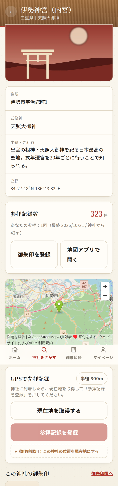
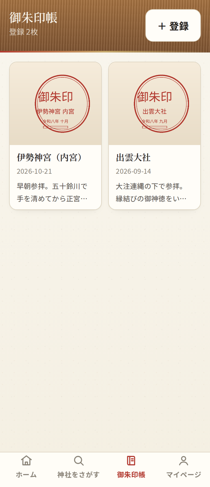

# 神旅帳（かみたびちょう）

全国47都道府県・100社の神社をめぐり、**参拝記録**と**御朱印**を残す神社巡礼アプリ（MVP）。
スマホファーストのPWAで、Firebase を接続すればそのまま本番運用できます。

<p>
  
  
  
</p>

## 主な機能

| 機能 | 概要 |
| --- | --- |
| 神社をさがす | 現在地から近い順、都道府県別、神社名・祭神・住所での検索 |
| GPS チェックイン | 神社から **300m以内** のときのみ参拝記録を登録（距離はヘヴァサイン公式で算出） |
| 御朱印帳 | 写真・参拝日・メモを保存（写真は Firebase Storage へ） |
| マイページ | 総参拝数・参拝した神社数・御朱印数・訪問履歴 |
| プロフィール | ニックネームとプロフィール画像 |
| PWA | ホーム画面に追加してスタンドアロン起動、オフライン時は案内ページ |

## GitHub Web Upload で公開する場合

GitHub の Web アップロードは1回100ファイルまでのため、神社データは
[`src/data/shrines.json`](src/data/shrines.json) の**1ファイル**に集約し、
神社画像は `public/images/shrine-1.webp` 〜 `shrine-6.webp` の6枚に統合しています。
全86ファイル・最大フォルダ19ファイルなので、Web UI だけでもアップロードできます。
手順は [`docs/GITHUB_WEB_UPLOAD.md`](docs/GITHUB_WEB_UPLOAD.md) を参照してください。

## 技術構成

| 領域 | 技術 |
| --- | --- |
| フレームワーク | Next.js 15（App Router）/ React 19 / TypeScript（strict） |
| スタイル | Tailwind CSS v4（和風モダンのデザイントークン） |
| 認証 | Firebase Authentication（Google ログイン） |
| データ | Cloud Firestore（`users` / `shrines` / `visit_history` / `goshuin` の4コレクション） |
| 画像 | Firebase Storage（`goshuin/{uid}/`, `avatars/{uid}/`） |
| 地図 | Google Maps JavaScript API（未設定時は OpenStreetMap の簡易地図） |
| PWA | Web App Manifest + Service Worker |

## すぐに動かす

```bash
nvm use            # Node 22（.nvmrc）
npm install
npm run dev        # http://localhost:3000
```

Firebase の環境変数が無くても **デモモード**（ブラウザ内 `localStorage`）で全画面が動作します。
「デモモードで試す」でログインしてください。

動作確認用のショートカット:

- `/?autologin=1&sample=1` — デモログイン＋サンプルの参拝記録・御朱印つきで起動
- 神社詳細の「動作確認用：この神社の位置を現在地にする」 — 実機なしで300m判定を確認
- `/?demo=1` — Firebase 設定済みでもデモモードで起動

> 検証用ツールは Firebase 接続時は既定で非表示です（`NEXT_PUBLIC_ENABLE_DEMO_TOOLS=true` で表示）。

## Firebase に接続する

```bash
cp .env.local.example .env.local   # NEXT_PUBLIC_FIREBASE_* を記入
npm run seed                       # 神社マスタ100件を Firestore へ投入
npm run build && npm start
```

セキュリティルールとインデックスもリポジトリに含まれます。

```bash
firebase deploy --only firestore:rules,firestore:indexes,storage
```

詳細は [`docs/DEPLOY.md`](docs/DEPLOY.md)、リリース前の確認項目は
[`docs/RELEASE_CHECKLIST.md`](docs/RELEASE_CHECKLIST.md) を参照してください。

## 環境変数

| 変数 | 必須 | 用途 |
| --- | --- | --- |
| `NEXT_PUBLIC_FIREBASE_API_KEY` | Firebase 利用時 | Authentication / Firestore / Storage |
| `NEXT_PUBLIC_FIREBASE_AUTH_DOMAIN` | 〃 | 〃 |
| `NEXT_PUBLIC_FIREBASE_PROJECT_ID` | 〃 | 〃 |
| `NEXT_PUBLIC_FIREBASE_STORAGE_BUCKET` | 〃 | 〃 |
| `NEXT_PUBLIC_FIREBASE_MESSAGING_SENDER_ID` | 〃 | 〃 |
| `NEXT_PUBLIC_FIREBASE_APP_ID` | 〃 | 〃 |
| `NEXT_PUBLIC_GOOGLE_MAPS_API_KEY` | 任意 | 未設定なら OpenStreetMap の簡易地図 |
| `NEXT_PUBLIC_SITE_URL` | 任意 | OGP / canonical |
| `NEXT_PUBLIC_ENABLE_DEMO_TOOLS` | 任意 | 検証用ツールの表示切り替え（`true`/`false`） |

`NEXT_PUBLIC_*` はブラウザに配信されます。**秘密情報は入れないでください。**

## スクリプト

| コマンド | 内容 |
| --- | --- |
| `npm run dev` | 開発サーバー（0.0.0.0:3000） |
| `npm run build` / `npm start` | 本番ビルド / 起動 |
| `npm run lint` | ESLint（`next/core-web-vitals` + TypeScript） |
| `npm run typecheck` | 型チェック（`tsc --noEmit`） |
| `npm run seed` | 神社マスタ100件を Firestore へ投入 |
| `node scripts/gen-shrines.mjs` | 神社データの再生成（`src/data/shrines.json`） |

## ディレクトリ構成

```
src/
  app/                     画面（App Router）
    page.tsx                 ホーム（現在地・地図・周辺神社・訪問済件数）
    login/page.tsx           ログイン
    shrines/page.tsx         神社一覧（都道府県別・名前検索）
    shrines/[id]/page.tsx    神社詳細（チェックイン・御朱印登録）
    goshuin/page.tsx         御朱印帳
    goshuin/new/page.tsx     御朱印の登録
    mypage/page.tsx          マイページ
    profile/page.tsx         プロフィール編集
    error.tsx / global-error.tsx / not-found.tsx   エラー・404
  components/              UI 部品（AppShell / ShrineMap / CheckInPanel など）
  lib/                     型・位置情報・エラー変換・Firebase 連携・状態管理
  data/shrines.json        神社マスタ100件（単一ファイル・自動生成）
  data/shrines.ts          上記JSONの読み込みと型付け
firestore/                 セキュリティルール・インデックス
scripts/                   データ生成・投入・スクリーンショット取得
docs/                      デプロイ手順・リリースチェックリスト・画面キャプチャ
```

## セキュリティ

- Firestore / Storage は本人のドキュメントのみ読み書き可（[`firestore.rules`](firestore.rules) / [`storage.rules`](storage.rules)）
- 300m 制限はクライアント実装に加え、**ルールでも `distance_m <= 300` を強制**
- 脆弱性の報告は [SECURITY.md](SECURITY.md) を参照

## データについての注意

`src/data/shrines.json` の緯度経度は**境内代表点の概略値**です。本番運用の前に必ず公式情報で検証してください。
`visit_count` の初期値もサンプル値です（本番ではチェックイン時に加算されます）。

## 今回実装していない機能（将来バージョン）

祭神カード / 神話図鑑 / ランキング / SNS / デジタル巡拝印 / バッジ / 通知 / AIチャット / AI神話解説 / 管理者画面

## ライセンス

[MIT](LICENSE)
